<h1 align="center">Hey, I'm Gabriel 👋</h1>

  <b>Full-Stack Software Engineer · Founder of <a href="https://nextclip.net">NextClip</a></b> 
  I love building and shipping. Mostly working on full-stack web and iOS apps.

  
  &nbsp;&nbsp;&nbsp;&nbsp;
  
  &nbsp;&nbsp;&nbsp;&nbsp;
  

---

### 🙋 About Me

- 🚀 Currently Building **NextClip.net**, an all in one platform for brands to run everything from organic content to paid ads working with creators seamlessly.
- 💡 BIG interest in the creator economy and building consumer & B2B web and mobile apps surrounding it.
- 🛠️ Been shipping real products since 2021.
- 📍 Located in St. Pete, FL.
- ☕ Addicted to UX.

### 💖 What I've Built & Been Apart Of

#### 🎬 [NextClip](https://nextclip.net)
**Creator Marketing Platform** 
Helps brands build and manage teams of creators, track how their content performs, pay them automatically, and turn the best videos into paid ads.

#### 🥗 [Healthy Pantry](https://healthypantry.app)
**Nutrition App** 
Helps people track what they eat, follow their progress, and get personalized guidance from an AI chat and voice assistant.

#### 🧠 [OpGen.ai](https://opgen.ai)
**AI Game Intelligence** 
Helps players understand complex strategy games through conversational AI and data-driven recommendations, starting with Hearthstone.

#### 💎 [TangibleNFTs](https://wax.atomichub.io/explorer/collection/wax-mainnet/tangiblenfts?analytics_period=all&analytics_page=1#accounts)
**Physical-Backed Collectibles** 
An NFT project connecting digital collectibles with custom physical products, with $15K+ in sales.
